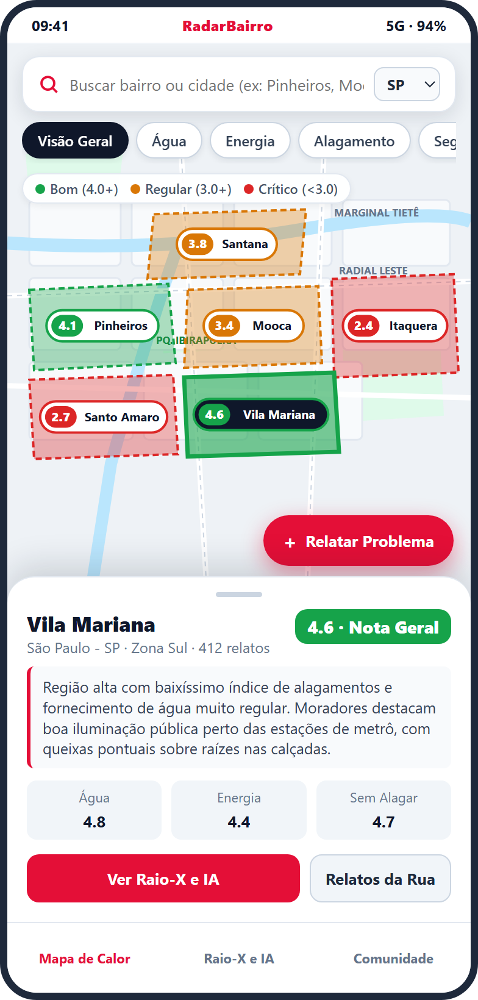
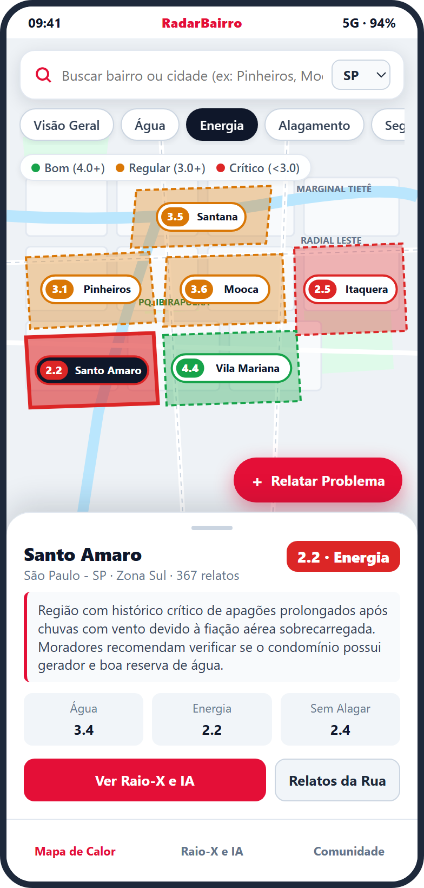
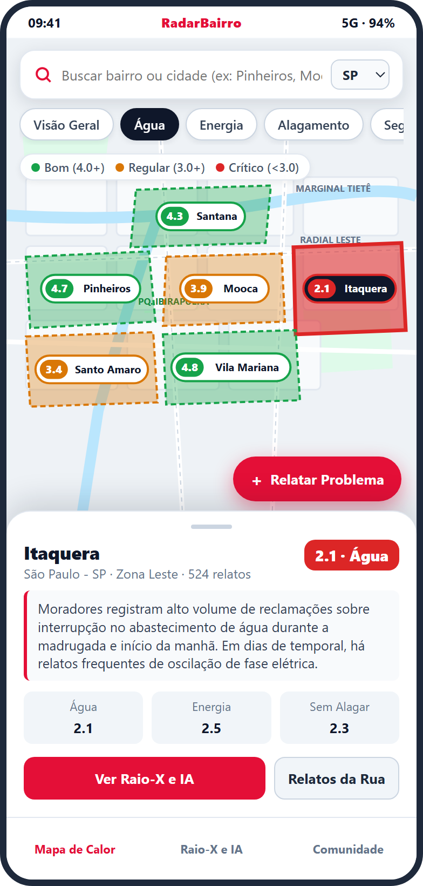
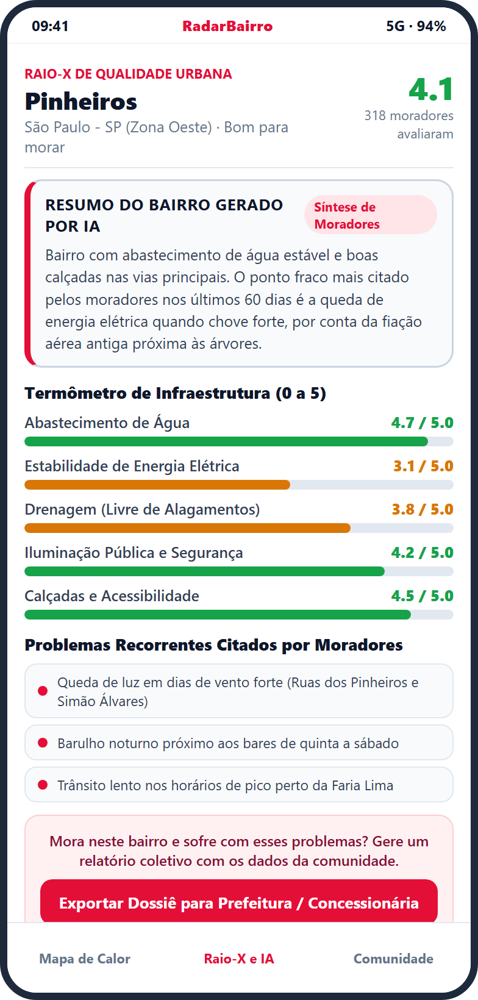
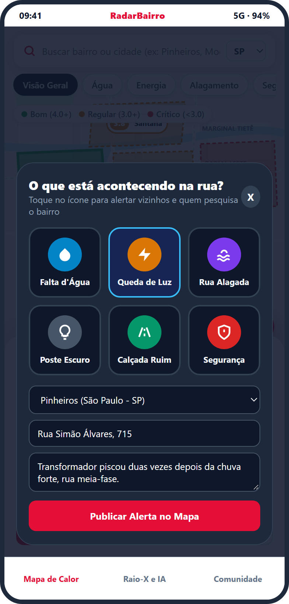
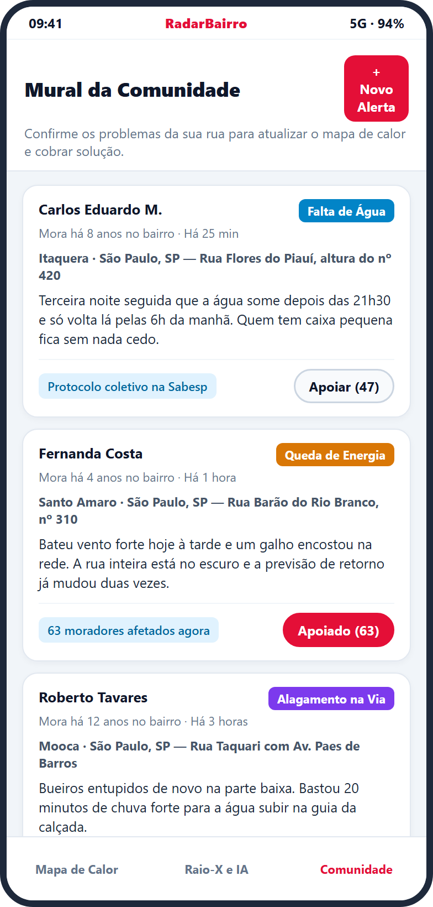
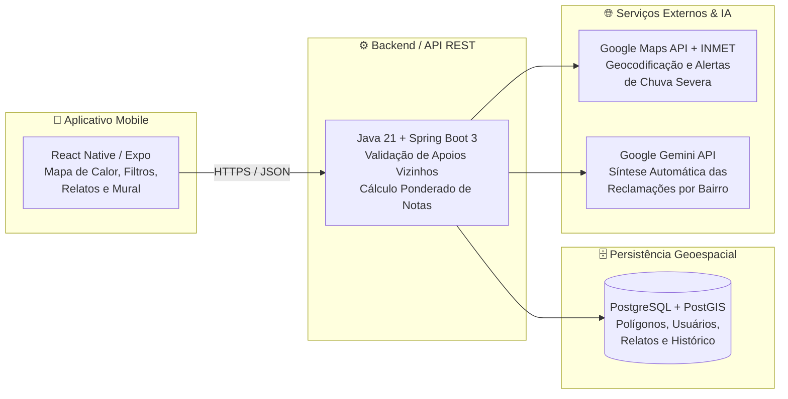

# RadarBairro — Mapa Colaborativo de Qualidade de Vida e Infraestrutura Urbana


[](https://radarbairro-beta.vercel.app)
[](https://www.youtube.com/watch?v=PsAmejXaunc)
[](https://renan-xavier.vercel.app)


> 🎓 **Projeto Acadêmico — Global Solution FIAP (2TDS)**  
> **Autor:** Renan Santa Rosa Xavier — RM 566997  
> **Curso:** Análise e Desenvolvimento de Sistemas — FIAP  
> 🌐 **Protótipo Interativo no Ar:** [radarbairro-beta.vercel.app](https://radarbairro-beta.vercel.app) | **Portfólio:** [renan-xavier.vercel.app](https://renan-xavier.vercel.app)

---

## 📌 Visão Geral do Projeto

O **RadarBairro** é uma plataforma mobile **CitizenTech** desenvolvida para a **Global Solution FIAP**, projetada para dar transparência real sobre a infraestrutura urbana e a qualidade de vida de cada bairro — **100% focada no cidadão e sem anúncios imobiliários**.

Hoje, quem procura um imóvel para alugar ou comprar escolhe o endereço no escuro e só descobre depois da mudança problemas crônicos como falta d'água noturna, quedas de energia a cada chuva forte, alagamentos na via ou falta de iluminação pública. Ao mesmo tempo, quem já mora no bairro fica sem saber se uma interrupção de água ou luz atingiu apenas sua residência ou a rua inteira, perdendo força para cobrar a prefeitura e as concessionárias.

O **RadarBairro** une esses dois públicos na mesma base comunitária:
1. **Para quem vai se mudar (Inquilinos, Famílias, Estudantes e Idosos):** Consulta um **mapa de calor colorido** (Verde `>= 4.0`, Amarelo `3.0–3.9`, Vermelho `< 3.0`) com filtros por categoria (`Água`, `Energia`, `Alagamento`, `Segurança`, `Calçadas`) e um **Resumo do Bairro gerado por IA** que sintetiza centenas de relatos reais dos moradores.
2. **Para quem já mora no bairro:** Registra alertas rápidos da rua em segundos, confirma relatos dos vizinhos através do botão **Apoiar** (evitando *fake news* e dando peso estatístico ao mapa de calor) e exporta **dossiês coletivos** para pressionar prefeituras e concessionárias.

---

## 🎬 Demonstração & Links de Avaliação

### 1. Protótipo Mobile Navegável (Hospedado na Vercel)
Teste todos os fluxos em tempo real (troca de estados `SP`, `RJ`, `MG`, busca por bairro, filtros de camada no mapa, abertura de *Bottom Sheet*, Raio-X com IA, painel de alerta rápido e validação no mural da comunidade):

👉 **[Acessar Protótipo Interativo — radarbairro-beta.vercel.app](https://radarbairro-beta.vercel.app)**

### 2. Vídeo Pitch Oficial no YouTube (Até 3 Minutos)
Confira a apresentação completa do problema, proposta, demonstração do protótipo e arquitetura técnica:

[](https://www.youtube.com/watch?v=PsAmejXaunc)

> 🔗 **Assistir no YouTube:** [https://youtu.be/PsAmejXaunc](https://youtu.be/PsAmejXaunc)  
> 📄 **Apresentação Executiva (PDF 16:9):** [Apresentacao_RadarBairro_RM566997.pdf](Apresentacao_RadarBairro_RM566997.pdf)

---

## 📱 Galeria de Telas do Protótipo

### 1. Mapa de Calor Colaborativo e Filtros Rápidos por Camada
| Visão Geral do Mapa + Aba Inferior | Filtro de Energia (Apagões Críticos) | Filtro de Água (Falta de Abastecimento) |
| :---: | :---: | :---: |
|  |  |  |
| *Polígonos em verde, amarelo e vermelho com Bottom Sheet do bairro selecionado.* | *Recolore o mapa destacando regiões com quedas de luz em dias de chuva.* | *Evidencia bairros periféricos ou altos que sofrem com cortes noturnos de água.* |

### 2. Raio-X com Inteligência Artificial, Alerta Rápido e Mural Comunitário
| Raio-X do Bairro + Resumo por IA | Painel Escuro de Alerta Rápido | Mural da Comunidade + Botão Apoiar |
| :---: | :---: | :---: |
|  |  |  |
| *Síntese gerada por IA, barras horizontais de 0 a 5 e exportação de dossiê.* | *Seis ícones grandes e coloridos para o morador reportar problemas em segundos.* | *Feed de ocorrências da rua com confirmação entre vizinhos para validar dados.* |

---

## 🎨 Engenharia de UX/UI: As 4 Referências e O Que Faltava Nelas

Para criar uma interface intuitiva desde o primeiro uso, o **RadarBairro** combinou os melhores padrões de usabilidade de quatro grandes aplicativos do mercado, preenchendo a lacuna que faltava em cada um deles:

| Referência | O que trouxemos para o RadarBairro | O que faltava no sistema original |
| :--- | :--- | :--- |
| **1. QuintoAndar** | **Pílulas de filtro no topo** (`Água`, `Energia`, `Alagamento`, `Segurança`, `Calçadas`) e **aba inferior (*Bottom Sheet*)** que sobe sem esconder o mapa. | Focado na venda e locação de imóveis; não mostra problemas crônicos de infraestrutura da rua. |
| **2. Waze** | **Botão flutuante (`+ Relatar Problema`)** com fundo escuro e **6 ícones circulares grandes** para envio de alertas em poucos segundos. | Restrito ao trânsito imediato; não constrói histórico de qualidade de vida ou saneamento do bairro. |
| **3. Colab** | **Mural da Comunidade** em formato de feed local com botão **Apoiar**, onde vizinhos confirmam que o problema está afetando a rua. | Focado em protocolos individuais com prefeituras, sem visão consolidada em mapa de calor para quem pesquisa onde morar. |
| **4. Airbnb** | **Barras horizontais de avaliação (0 a 5)** por categoria e card de destaque com **Resumo do Bairro gerado por IA**. | Avaliações restritas à estadia temporária dentro do imóvel, sem diagnóstico contínuo dos serviços públicos do entorno. |

---

## 🏛️ Arquitetura do Sistema e Integrações

A arquitetura planejada para produção conecta o aplicativo mobile a uma API REST em Java Spring Boot, banco geoespacial e serviços externos de mapas, meteorologia e IA generativa:



---

## 🌍 Alinhamento com os Objetivos de Desenvolvimento Sustentável (ODS da ONU)

- **ODS 11 — Cidades e Comunidades Sustentáveis:** Promove urbanização inclusiva e segura ao mapear pontos críticos de alagamento, iluminação pública, saneamento básico e acessibilidade de calçadas.
- **ODS 10 — Redução das Desigualdades:** Dá visibilidade estatística para bairros periféricos que sofrem com interrupções recorrentes de água e energia, gerando relatórios técnicos para cobrança de investimentos públicos.
- **ODS 09 — Indústria, Inovação e Infraestrutura:** Monitora falhas na rede elétrica e de drenagem urbana de forma colaborativa, orientando prioridades reais de manutenção.

---

## 📂 Estrutura do Repositório

```text
CitizenTech/
├── Apresentacao_RadarBairro_RM566997.pdf   # Apresentação executiva final (11 slides 16:9 em PDF)
├── INICIAR_PROTOTIPO.bat                   # Atalho rápido para abrir o protótipo localmente no Windows
├── README.md                               # Documentação acadêmica e técnica do projeto
├── prototipo/                              # Código-fonte do protótipo mobile navegável (deployado na Vercel)
│   ├── index.html                          # Estrutura mobile-first (Mapa, Raio-X IA, Modal Waze e Mural Colab)
│   ├── estilo.css                          # Design System inspirado em QuintoAndar, Waze, Colab e Airbnb
│   ├── dados.js                            # Base simulada de estados (SP, RJ, MG), polígonos, notas e relatos
│   └── app.js                              # Lógica interativa de busca, filtros de camada, apoios e novos alertas
└── apresentacao/                           # Código-fonte dos slides e capturas de alta resolução
    ├── apresentacao-radarbairro.html       # Slides 16:9 em HTML/CSS puro
    ├── apresentacao-radarbairro.pdf        # Versão compilada em PDF
    ├── colinha-apresentacao.md             # Roteiro estruturado do Vídeo Pitch (até 3 minutos)
    ├── gerar-pdf.cmd                       # Script de exportação automatizada HTML -> PDF via navegador headless
    └── tela_01_mapa_geral.png ... tela_06  # Capturas reais do protótipo mobile
```

---

## 🚀 Como Executar Localmente

1. Clone este repositório:
   ```bash
   git clone https://github.com/Renan-Xavier/RadarBairro.git
   cd RadarBairro
   ```
2. Abra o arquivo `prototipo/index.html` diretamente no navegador (ou dê dois cliques em `INICIAR_PROTOTIPO.bat` no Windows).
3. Ou acesse diretamente a versão publicada na Vercel: **[https://radarbairro-beta.vercel.app](https://radarbairro-beta.vercel.app)**
